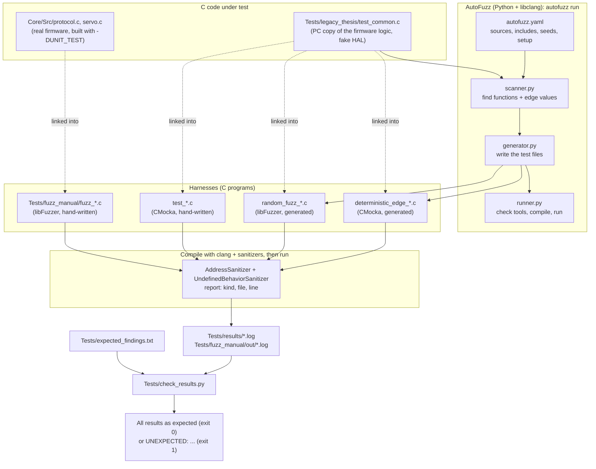

# Architecture

This page shows how the parts fit together, from the C code to the line
`All results as expected`. For a step-by-step example, see
[HOW_IT_WORKS.md](HOW_IT_WORKS.md).

## The flow



There are two paths:

- **Left path: the thesis tool (legacy).** `autofuzz run` reads
  `Tests/legacy_thesis/autofuzz.yaml`, which points to `test_common.c`,
  and writes, compiles and runs tests for it. All tests in
  `Tests/legacy_thesis/` run on this **copy** of the firmware logic.
- **Right path: the hand-written fuzzers.** `Tests/fuzz_manual/` links the
  **real** `Core/Src/protocol.c` and `servo.c`. Nothing is generated here.

Milestone M4 in the [roadmap](ROADMAP.md) joins the two paths: AutoFuzz will
read the real `Core/Src` files.

## The parts

| Part | Where | What it does |
|---|---|---|
| Code under test (copy) | `Tests/legacy_thesis/test_common.c/.h` | The protocol and servo logic, copied for the PC, with fake HAL functions. Has its own `protocol_defs.h`, `servo_defs.h`. |
| Code under test (real) | `Core/Src/protocol.c`, `servo.c` | The firmware. With `-DUNIT_TEST` it includes `Tests/fuzz_manual/test_common.h` (HAL stubs) instead of the STM32 headers. |
| Config | `autofuzz.yaml` (here: `Tests/legacy_thesis/autofuzz.yaml`), loaded by `autofuzz/config.py` | Everything specific to one project: sources, include dirs, defines, string seeds, struct setup, fuzz time. Merged on top of `autofuzz/defaults.yaml`. See [CONFIG.md](CONFIG.md). |
| Command line | `autofuzz/__main__.py` | `autofuzz init / check / generate / build / run / clean`. `autofuzz` = `python3 -m autofuzz`. |
| Scanner | `autofuzz/scanner.py` | Uses libclang to find every non-static function in `sources`. Collects edge values per parameter: defaults per type, plus numbers and strings it finds in the code (comparisons, `switch` cases, literals). |
| Generator | `autofuzz/generator.py`, started by `autofuzz/main.py` | Keeps at most `edge_cap` (12) values per parameter. Writes one `deterministic_edge_<fn>.c` and one `random_fuzz_<fn>.c` per function into `autofuzz-out/gen/`. The same input always gives the same files. |
| Runner | `autofuzz/runner.py` | Checks that the tools are installed (and prints the install command if not), compiles with clang (no Makefile needed), runs the edge tests and fuzzers, and writes `autofuzz-out/logs/`. |
| Hand-written unit tests | `Tests/legacy_thesis/test_*.c` | CMocka tests that say how the protocol should behave. |
| Hand-written fuzzers | `Tests/fuzz_manual/fuzz_*.c` | libFuzzer harnesses for the real firmware: one command, a full session, and the UART DMA callback. |
| Sanitizers | compiler flags in the Makefiles | `-fsanitize=address,undefined` (and `integer` for fuzzers). They stop the program at a memory error or undefined behaviour and print the file and line. |
| Results check | `Tests/check_results.py` | Reads all logs, turns each `SUMMARY:` line and each CMocka `[  FAILED  ]` line into a finding, and compares them with `Tests/expected_findings.txt`. |

## Commands

Run these from the repository root.

| Command | Steps | Time |
|---|---|---|
| `make deps` | `autofuzz check`: clang, CMocka, sanitizer + libFuzzer runtimes, libclang, PyYAML. Prints the install command for anything missing. | 2 s |
| `make build` | `make deps` → hand-written unit tests → `autofuzz build --config Tests/legacy_thesis/autofuzz.yaml` → `Tests/fuzz_manual` fuzzers | ~30 s |
| `make test` | `make build` → unit tests → `autofuzz run --fresh` (edge tests + generated fuzzers, 10 s each) → manual fuzzers (10 s each) → `make check-determinism` → `check_results.py` | ~3 min |
| `make check-determinism` | Runs `autofuzz generate` twice and compares the outputs with `diff -r`. | 5 s |
| `make fuzz` | The same fuzzers, but longer (`FUZZ_MAX_SECS`, default 60 s each). Exits with 1 if anything is found. | ~13 min |
| `make clean` | Deletes everything that the commands above created. | 1 s |

Change the times: `make fuzz FUZZ_MAX_SECS=600`, `make test TEST_FUZZ_SECS=30`.

Run only a part (after `make build`):

```bash
make -C Tests/legacy_thesis unit          # or: edge, fuzz
python3 -m autofuzz run --config Tests/legacy_thesis/autofuzz.yaml --only edge
cd Tests/legacy_thesis && ./test_protocol_checksum.elf
cd Tests/legacy_thesis/autofuzz-out && ./bin/deterministic_edge_<Function>
cd Tests/legacy_thesis/autofuzz-out && ./bin/random_fuzz_<Function> -max_total_time=10 corpus/random_fuzz_<Function>
make -C Tests/fuzz_manual run-fuzz_protocol_cmd FUZZ_MAX_SECS=30
./<fuzzer> <crash file>                   # run a saved crash again
```

`make test` exits with 0 only if the findings are **exactly** the expected
ones. The tests are meant to find bugs; see [FINDINGS.md](FINDINGS.md).
When the result is different, the last line starts with `UNEXPECTED:`, and the
lines above it list each difference (a new finding, an expected finding that
is gone, or a test that did not run). A `maybe` line in
`Tests/expected_findings.txt` is a bug that a short fuzzing run finds only
sometimes; it is allowed but not required.

## Folder map

```
Core/, Drivers/              STM32 firmware (CubeMX project, HAL library)
ServoProject.ioc             CubeMX project file
Makefile                     the commands above (PC tests only)
Dockerfile                   Ubuntu 24.04 + clang 18 test environment
Dockerfile.ubuntu20          Ubuntu 20.04 + Python 3.8 + clang 10 (the oldest supported)
requirements.txt             Python packages for AutoFuzz (libclang, PyYAML)
pyproject.toml               `pip install .` gives the `autofuzz` command

autofuzz/                    the AutoFuzz tool (Python package)
  __main__.py                command line: init | check | generate | build | run | clean
  config.py                  loads and checks autofuzz.yaml
  defaults.yaml              default settings (generic string seeds, limits)
  init_template.yaml         what `autofuzz init` writes
  main.py                    generate(): parse, find functions, write files
  scanner.py                 finds functions and edge values with libclang
  generator.py               writes deterministic_edge_*.c and random_fuzz_*.c
  runner.py                  checks tools, compiles with clang, runs the tests
  rt/autofuzz_rt.h           helpers for generated tests

Tests/legacy_thesis/         the thesis example: AutoFuzz + tests on a PC copy of the logic
  autofuzz.yaml              AutoFuzz config for test_common.c
  test_common.c/.h           PC copy of the protocol + servo logic, fake HAL
  test_*.c                   hand-written CMocka unit tests
  Makefile                   build | unit | edge | fuzz | test | clean
  autofuzz-out/              generated by AutoFuzz (not in git)

Tests/fuzz_manual/           hand-written libFuzzer harnesses for the REAL firmware
                             (see Tests/fuzz_manual/README.md)
Tests/check_results.py       compares the findings with the expected list
Tests/expected_findings.txt  the expected list
docs/                        these documents
```

Files created by `make` (`autofuzz-out/`, binaries, `build/`, `out/`,
`Tests/results/`) are not in git.
`make build` creates them again.

`Tests/legacy_thesis` has its own copies of `protocol_defs.h` and
`servo_defs.h`. They are slightly different from `Core/Inc` (for example
`SERVO_MIN_PULSE`/`SERVO_MAX_PULSE`).

## Building the firmware

The firmware is built with **STM32CubeIDE** (tested with 1.17), not with the
Makefile in this repository. The CubeIDE project files (`.project`,
`.cproject`) are not in git. In CubeIDE use *File → New → STM32 Project from
an Existing STM32CubeMX Configuration File (.ioc)* and choose
`ServoProject.ioc`.

## CI

`.github/workflows/unit-and-fuzz.yml` runs on every push and pull request, in
three jobs:

- **native**: Ubuntu 24.04: `make deps`, `make build`, `make test`. If the
  results are unexpected, the logs are uploaded as an artifact.
- **docker**: `docker build` and `docker run` (runs `make test` in the image).
- **ubuntu20**: the same with `Dockerfile.ubuntu20` (Ubuntu 20.04, Python 3.8,
  clang 10), the oldest supported system: `make deps`, `make build`, `make test`.

"Run workflow" on GitHub also starts a longer `make fuzz` (default 300 s per
fuzzer) and uploads its results.
