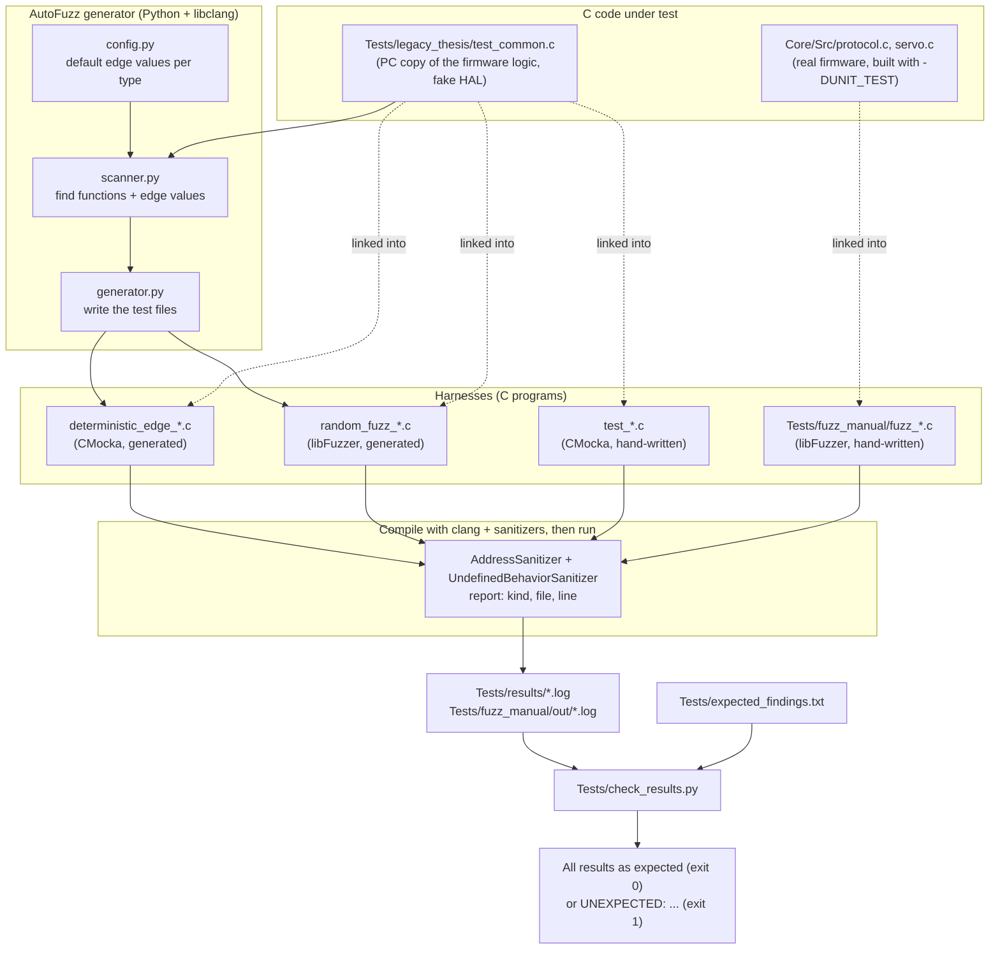

# Architecture

This page shows how the parts fit together, from the C code to the line
`All results as expected`. For a step-by-step example, see
[HOW_IT_WORKS.md](HOW_IT_WORKS.md).

## The flow

There are two paths:

- **Left path: the thesis tool (legacy).** AutoFuzz reads
  `test_common.c` and writes tests for it. All tests in
  `Tests/legacy_thesis/` run on this **copy** of the firmware logic.
- **Right path: the hand-written fuzzers.** `Tests/fuzz_manual/` links the
  **real** `Core/Src/protocol.c` and `servo.c`. Nothing is generated here.

Milestone M4 in the [roadmap](ROADMAP.md) joins the two paths: AutoFuzz will
read the real `Core/Src` files.

## The parts

| Part | Where | What it does |
|---|---|---|
| Code under test (copy) | `Tests/legacy_thesis/test_common.c/.h` | The protocol and servo logic, copied for the PC, with fake HAL functions. Has its own `protocol_defs.h`, `servo_defs.h`. |
| Code under test (real) | `Core/Src/protocol.c`, `servo.c` | The firmware. With `-DUNIT_TEST` it includes `Tests/fuzz_manual/test_common.h` (HAL stubs) instead of the STM32 headers. |
| Scanner | `Tests/legacy_thesis/autofuzz/scanner.py` | Uses libclang to find every non-static function with parameters. Collects edge values per parameter: defaults from `config.py`, plus numbers and strings it finds in the code (comparisons, `switch` cases, literals). |
| Generator | `Tests/legacy_thesis/autofuzz/generator.py` | Keeps at most 12 values per parameter. Writes one `deterministic_edge_<fn>.c` and one `random_fuzz_<fn>.c` per function. The same input always gives the same files. |
| Entry point | `Tests/legacy_thesis/autofuzz/main.py` | Runs scanner, then generator. Started by `make build` (`python3 -m autofuzz.main`). |
| Hand-written unit tests | `Tests/legacy_thesis/test_*.c` | CMocka tests that say how the protocol should behave. |
| Hand-written fuzzers | `Tests/fuzz_manual/fuzz_*.c` | libFuzzer harnesses for the real firmware: one command, a full session, and the UART DMA callback. |
| Sanitizers | compiler flags in the Makefiles | `-fsanitize=address,undefined` (and `integer` for fuzzers). They stop the program at a memory error or undefined behaviour and print the file and line. |
| Results check | `Tests/check_results.py` | Reads all logs, turns each `SUMMARY:` line and each CMocka `[  FAILED  ]` line into a finding, and compares them with `Tests/expected_findings.txt`. |

## What `make` does

| Command | Steps |
|---|---|
| `make build` | `make deps` → in `Tests/legacy_thesis`: run AutoFuzz, compile edge tests, fuzzers, unit tests → in `Tests/fuzz_manual`: compile fuzzers |
| `make test` | `make build` → run unit tests, edge tests, generated fuzzers (10 s each), manual fuzzers (10 s each) → save logs in `Tests/results/` → `check_results.py` |
| `make fuzz` | same fuzzers, but longer (`FUZZ_MAX_SECS`, default 60 s each) |

`make test` exits with 0 only if the findings are **exactly** the expected
ones. The tests are meant to find bugs; see [FINDINGS.md](FINDINGS.md).

## CI

`.github/workflows/unit-and-fuzz.yml` runs `make deps`, `make build`,
`make test` on Ubuntu 24.04, and the same in Docker (`Dockerfile`).
A manual run ("Run workflow") also runs a long `make fuzz`.
